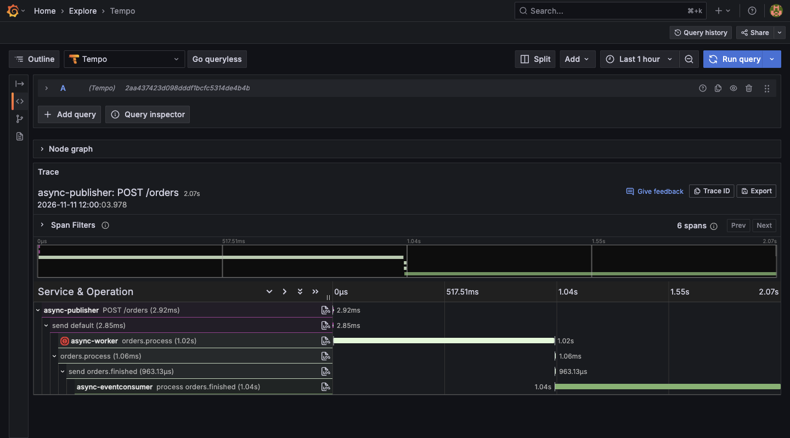
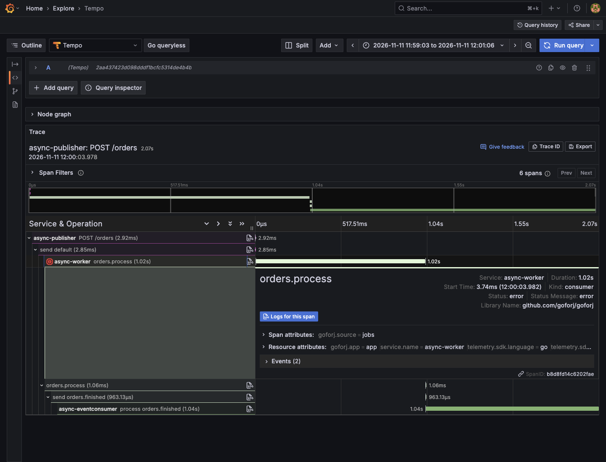
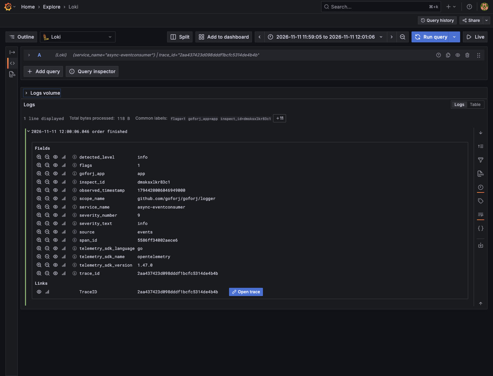

# Async Tracing in Grafana

Follow one order from an HTTP request through a failed job attempt, its retry,
and an event consumer in three separate processes. Tempo retains one trace
throughout. The consumer's application log arrives in Loki with the same trace
ID and its own span ID.

## Run the demo

From this checkout, with Go 1.26 or later, Docker Compose, `curl`, and `jq`
available, run:

```sh
scripts/demo-async-tracing.sh
```

The command prints the Grafana URL, trace ID, evidence directory, and cleanup
script after all backend checks pass. Default Grafana URL:
`http://127.0.0.1:23001`. Sign in with the generated local credentials
`admin` / `admin`, then skip the password change for this disposable demo.

The runner builds the current checkout, renders the generated Grafana stack
outside the repository, and starts its Alloy, Tempo, Loki, and metrics services.
It then runs the rendered application's cross-process integration fixture with
a real NATS broker. Initial image pulls and dependency downloads can take time.

To choose the evidence location, pass a new empty directory under `/tmp`:

```sh
scripts/demo-async-tracing.sh /tmp/my-async-tracing-demo
```

The command prints the same four results with evidence under that directory.
On failure, it saves diagnostics there and removes only its own Compose
containers and volumes.

Default host ports are listed below. Set the corresponding environment variable
when a port is already occupied. All published services bind to loopback.

| Variable | Default | Service |
| --- | --- | --- |
| `GRAFANA_PORT` | 23001 | Grafana |
| `TEMPO_HTTP_PORT` | 23200 | Tempo API |
| `TEMPO_OTLP_HTTP_PORT` | 24318 | Alloy OTLP HTTP receiver |
| `TEMPO_OTLP_GRPC_PORT` | 24317 | Alloy OTLP gRPC receiver |
| `LOKI_HTTP_PORT` | 23100 | Loki API |
| `OBSERVABILITY_VM_PORT` | 28428 | VictoriaMetrics |

The demo uses a Compose override giving Loki 128 MiB of memory-backed storage.
Demo logs are disposable and disappear when Loki restarts. The generated
application's storage configuration is unchanged.

## Explore the result

In Grafana Explore, select **Tempo**, choose **TraceQL**, paste the printed trace
ID, and run the query. Expand the span tree if needed.

### One trace across three processes

The HTTP publisher dispatches `orders.process`. Its first execution fails,
the retry publishes `orders.finished`, and the event consumer handles it.
Both job attempts remain children of the original queue producer span.



### The failed attempt remains visible

Select the first `orders.process` span to inspect its error status. The successful
retry is a separate sibling span, with its event publication nested beneath it.
The intentional failure demonstrates retry visibility rather than a broken demo.



### Navigate between the trace and its log

Select the logs icon on `process orders.finished`. Grafana opens Loki filtered
by service and trace ID. Expand the `order finished` entry to inspect its
`trace_id` and `span_id`. **Open trace** returns to the same six-span Tempo trace.



All three captures show the same real SDK export from this fixture, using fake
order data. Each run produces a new trace ID and timings.

## What the checks prove

- A real HTTP POST dispatches the order through the generated jobs manager.
- The publisher exits before the job handler continues. The worker exits before
  the event handler logs, proving context survives those process lifetimes.
- Generated observability managers and the application logger export OTLP. The
  fixture's receiver checks the spans and forwards the original protobuf exports
  to the generated Alloy receiver, which routes them to Tempo and Loki.
- Tempo contains exactly six spans with the expected trace IDs, span IDs,
  parents, names, and statuses.
- Loki contains `order finished` under the consumer service with the expected
  trace ID and event consumer span ID.

The evidence directory retains `report.json` (SDK expectations), `tempo.json`
and `loki.json` (backend responses), and `acceptance.log` (test output). The
normal integration test still runs without Grafana or the optional forwarding
endpoint. The demo adds no application runtime code or tracing configuration.

## Stop the demo

Run the cleanup script printed by the runner. For the explicit directory above:

```sh
/tmp/my-async-tracing-demo/cleanup.sh
```

Docker Compose removes only that demo's containers and volumes. Evidence files
remain available. Stop the demo before starting another on the same ports.
