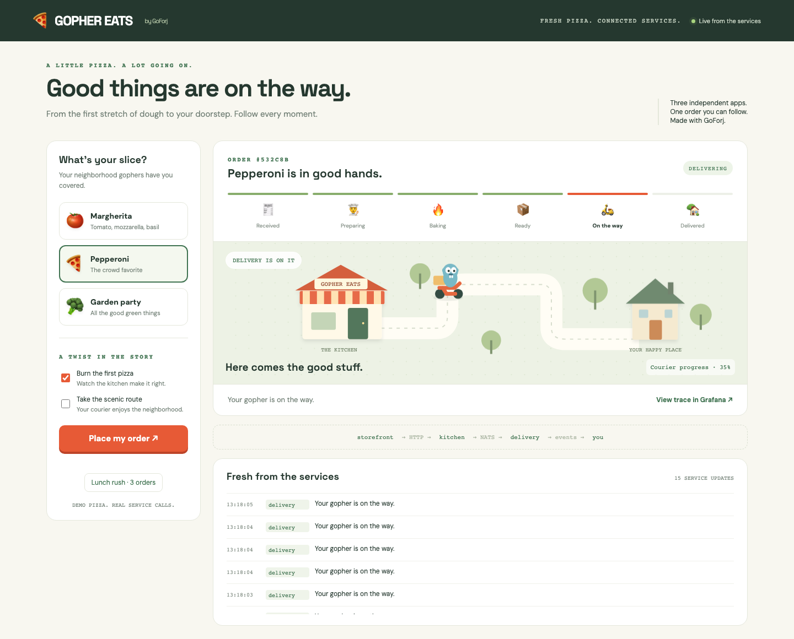
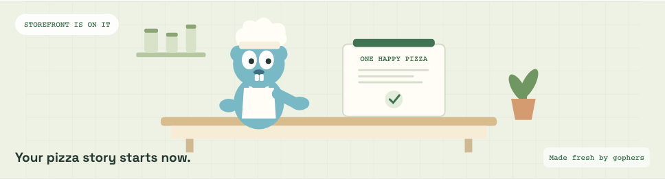
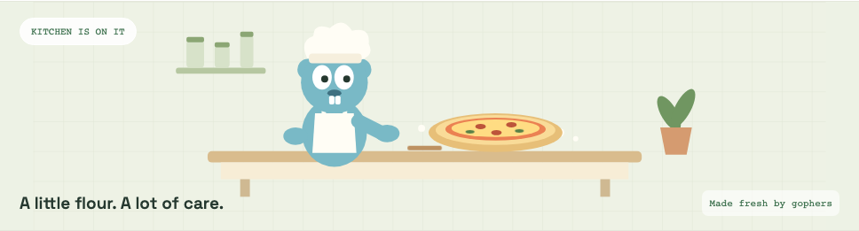
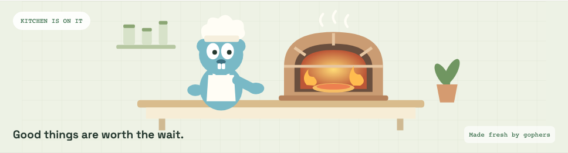
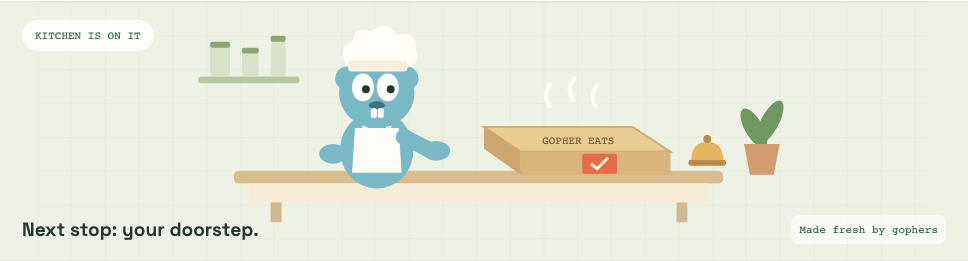
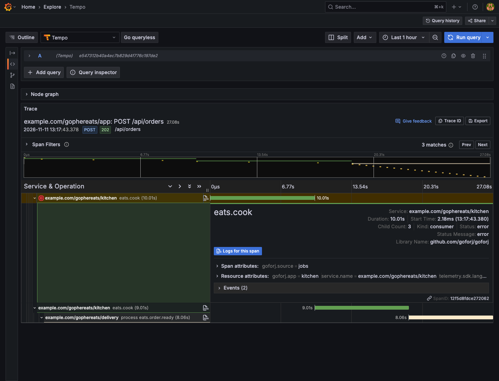
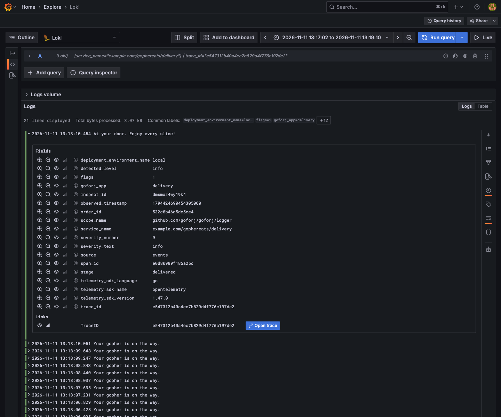

# Gopher Eats

A selectable reference app built on the Vue starter kit. Follow a pizza through
three GoForj Apps, with a live tracker, queued cooking, retries, cross-service
events, and correlated traces and logs.



## Create and run

Select **Gopher Eats (multi-app pizza delivery)** in the new-project wizard's
Demo App step. **Uptime Gopher (monitoring)** remains a separate choice.

With a CLI built from this checkout, noninteractive creation is:

```sh
forj new --no-interaction \
  --name="Gopher Eats" \
  --module=example.com/gophereats \
  --path=/tmp/gopher-eats \
  --components=cli \
  --starter-kit=none \
  --atlas=skip \
  --example=gopher_eats
```

The command initializes the project with the Vue frontend, three Apps,
NATS-backed queues and events, and the local Grafana stack. The example preset
selects Vue and its required components automatically.

```sh
cd /tmp/gopher-eats
forj dev
```

The development loop starts local services, builds the frontend and Apps, and
runs the storefront at `http://localhost:3000`. Grafana is available at
`http://localhost:13001`, with local credentials `admin` / `admin`.

## Follow your pizza

Each cooking stage has its own scene, driven by the corresponding service event:

| Received | Preparing |
| --- | --- |
|  |  |

| Baking | Ready |
| --- | --- |
|  |  |

Delivery switches to the neighborhood map. Preparing takes three seconds,
baking four, and pickup two by default. The courier moves in 5% increments,
with animation timing carried in the delivery events. Reduced-motion preferences
are respected.

- **Burn the first pizza** injects one oven failure and a real queue retry.
- **Take the scenic route** triples delivery time.
- **Lunch rush** sends three orders through one kitchen worker. Use the order
  tabs to switch trackers while the others continue.
- **View trace in Grafana** opens that order's actual Tempo trace. Follow its
  span logs link to Loki, then **Open trace** to navigate back.

| App | Responsibility | Default HTTP port |
| --- | --- | --- |
| `app` (storefront) | Vue UI, order acceptance, progress history, SSE | 3000 |
| `kitchen` | HTTP handoff, app-scoped queue, cooking and retry | 3002 |
| `delivery` | Ready-event consumer and courier progress | 3001 |

The storefront uses the existing instrumented HTTP client. Queue and event
propagation use the normal generated managers. The browser renders service
events; it does not advance orders on a separate timer. The order's trace ID is
used only to build the Grafana link.

The generated `internal/eats/README.md` covers code layout and configuration.
Example source is seeded once and preserved on rerender. Business state and
Core NATS delivery are disposable across restarts; a demo shift holds up to 100
orders.

## Inspect the same order

This Tempo capture filters to spans longer than 10 ms to highlight the failed
cooking attempt, retry, and delivery. HTTP and realtime fanout spans remain in
the full trace.



The delivery log includes the order ID, trace ID, consumer span ID, and a link
back to the order trace.



## Continuing acceptance coverage

The dedicated **gopher eats (multi-app demo)** CI job renders this example and:

- Typechecks and builds the Vue UI using the starter's existing lockfile and
  Vite configuration, then compares compiled assets with committed output.
- Tests reordered history, exact Grafana links, and actual Vue rendering of each
  kitchen scene, including the intentional failure.
- Builds and starts the three Go Apps with the race detector and a real NATS
  broker.
- Checks normal, retrying, and scenic orders, SSE reconnects, all 21 courier
  positions, and their animation intervals.
- Collects actual SDK OTLP exports and checks HTTP, queue, retry, and event
  parent relationships across service identities, plus consumer log correlation.

Run the same check from the framework checkout with Docker, Node 22, and Go 1.26:

```sh
go test -tags=integration_eats ./internal/forj -run '^TestRenderedGopherEats$' -count=1 -v
```

The test renders under `/tmp`, verifies all three scenarios, and removes its
temporary Apps and broker. The Grafana captures additionally exercise actual
ingestion into the generated Alloy, Tempo, and Loki stack.
